# X posts for Thu 12 Nov to Wed 18 Nov 2026

Schedule each one on x.com: **Post** → write/paste the text → attach the image(s) → **calendar icon** (Schedule) → pick the date & time → **Confirm** → **Schedule**.

All posts are educational only. Images already carry the disclaimer.

## Thu 12 Nov · 09:00 IST

```
Diversification means some part of your portfolio will always look bad.

That's not a mistake.
That's the design.

#investing

📲 Instagram & YouTube: hbecapital
```

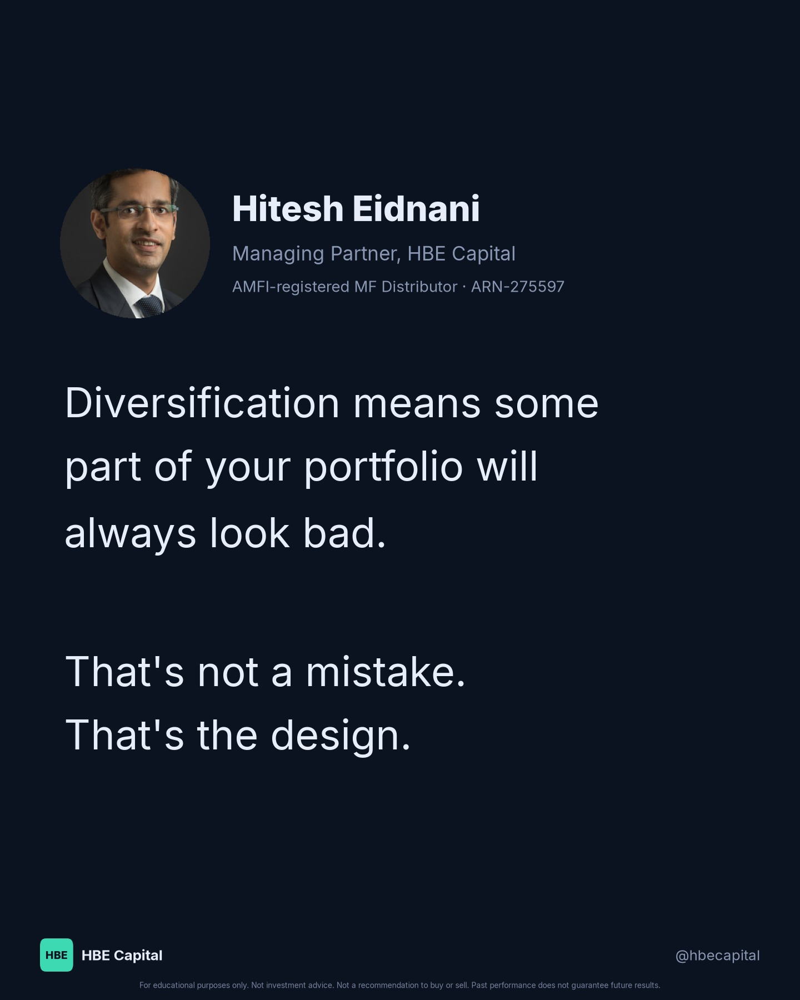

---

## Thu 12 Nov · 13:00 IST

```
"Win or lose, everybody gets what they want out of the market."
— Ed Seykota

Look honestly at your behaviour. Overtrading may be about excitement; refusing to sell losers may be about avoiding regret. Know what you're really after.

#tradingpsychology
```

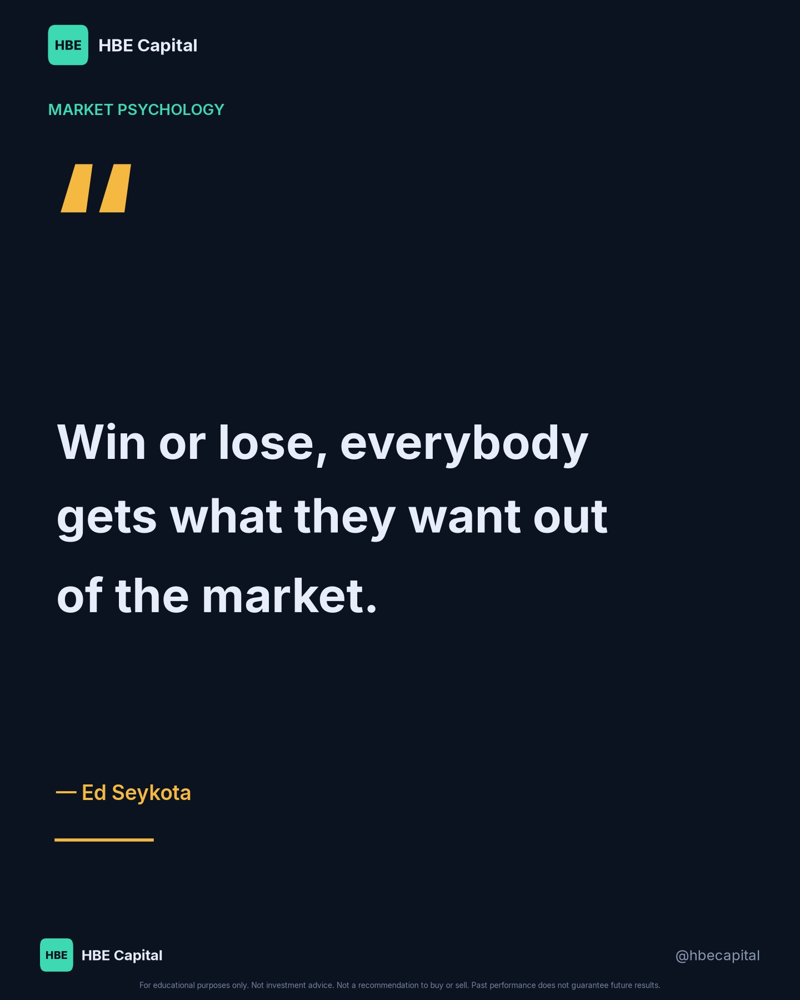

---

## Thu 12 Nov · 18:00 IST

```
MF Basics: ELSS: tax saving with growth

The 80C option with the shortest lock-in.

💡 ELSS combines tax saving with equity growth, if you're in the old tax regime.

#mutualfunds

📲 Instagram & YouTube: hbecapital
```


---

## Fri 13 Nov · 09:00 IST

```
Regular plan vs direct plan isn't the real debate.

The real cost is the investor who panics without anyone to call.

#investing

📲 Instagram & YouTube: hbecapital
```

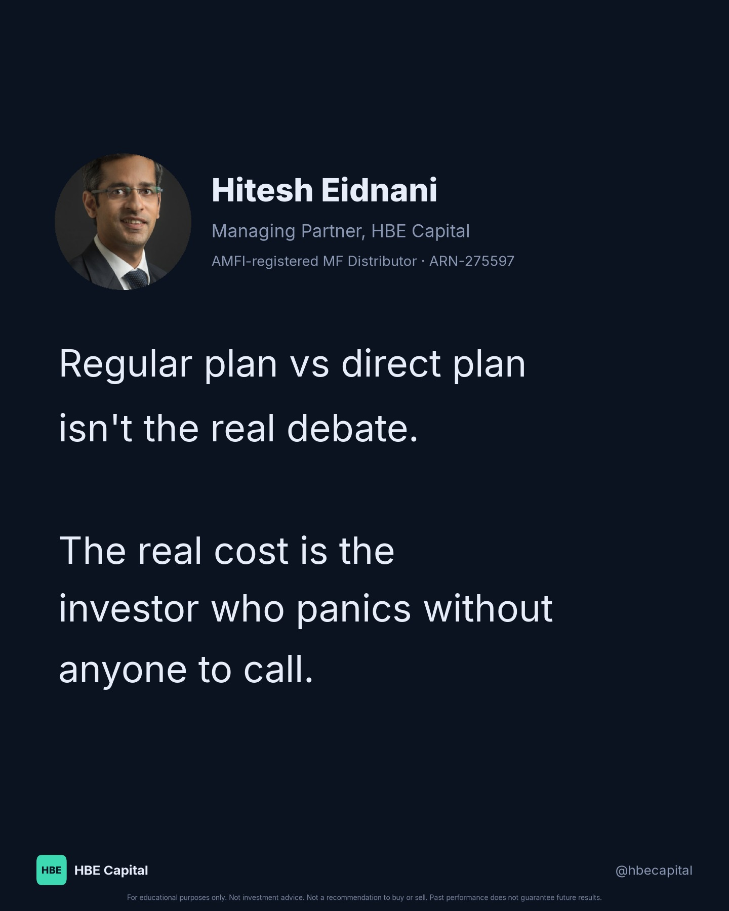

---

## Fri 13 Nov · 13:00 IST

```
"The four most dangerous words in investing are: this time it's different."
— Sir John Templeton

Every bubble comes with a story about why old rules no longer apply. They usually still do.

#tradingpsychology

📲 Instagram & YouTube: hbecapital
```

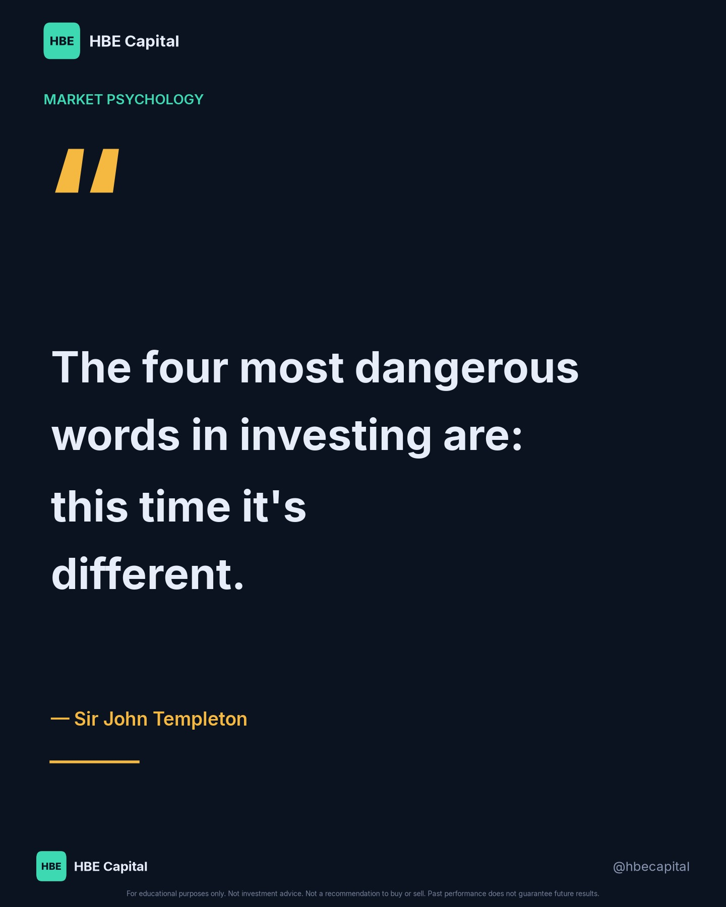

---

## Fri 13 Nov · 18:00 IST

```
Momentum's weak spot: crashes

The risk every momentum investor must respect.

💡 Momentum pays for its returns with occasional sharp crashes. Plan for them.

#momentuminvesting

📲 Instagram & YouTube: hbecapital
```


---

## Sat 14 Nov · 09:00 IST

```
Momentum doesn't predict the future.

It respects the present.

Price is the only opinion that pays.

#investing

📲 Instagram & YouTube: hbecapital
```

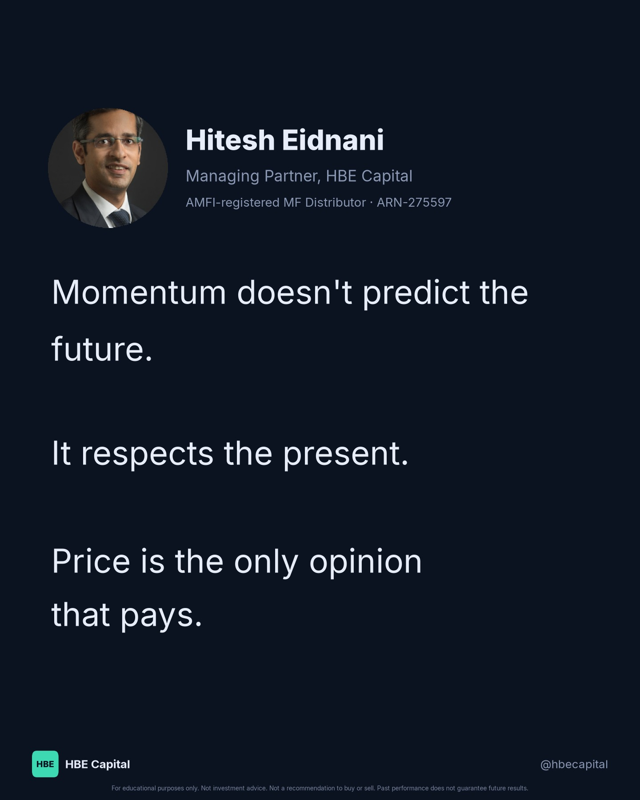

---

## Sat 14 Nov · 13:00 IST

```
"The hard, cold reality of trading is that every trade has an uncertain outcome."
— Mark Douglas

No analysis removes uncertainty. Position sizing and stop-losses are how you live with it.

#tradingpsychology

📲 Instagram & YouTube: hbecapital
```

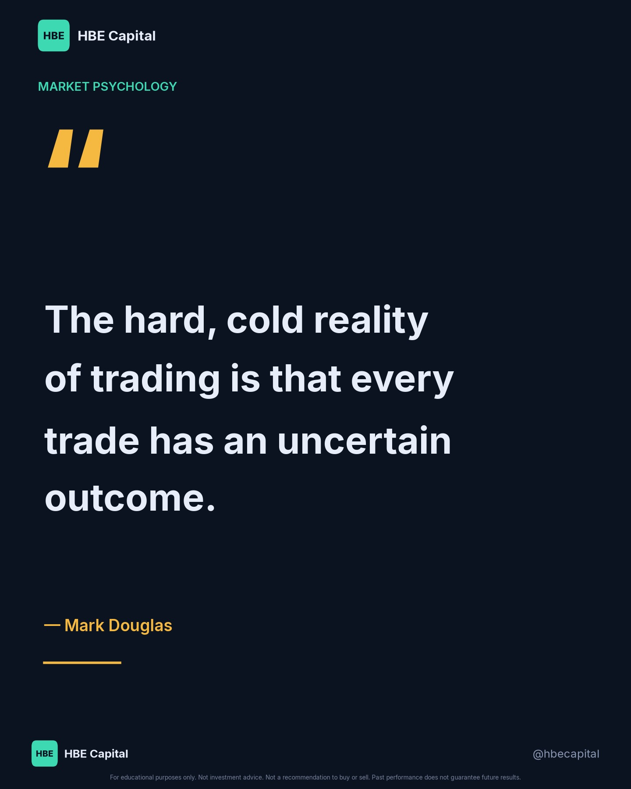

---

## Sat 14 Nov · 18:00 IST

```
"Be fearful when others are greedy and greedy when others are fearful."
— Warren Buffett

Crowd emotion creates the best and worst prices. Discipline means acting against it.

📲 Instagram & YouTube: hbecapital
```

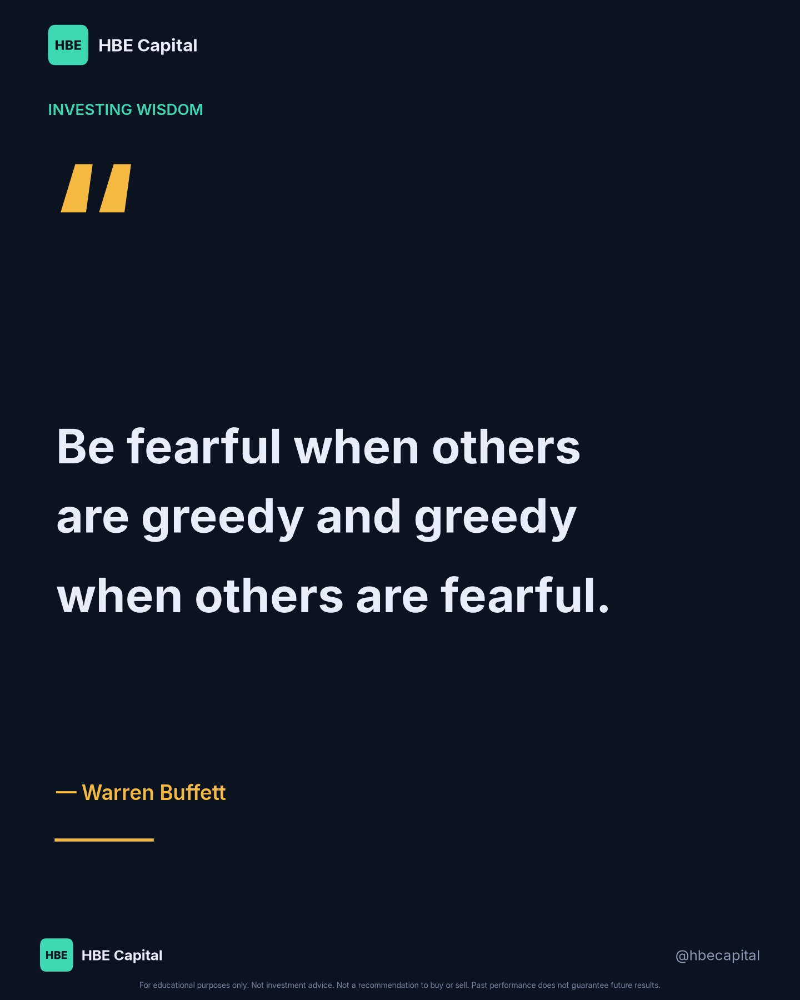

---

## Sun 15 Nov · 09:00 IST

```
Averaging down on a falling stock feels smart.

Usually it's just doubling a mistake.

Add to strength, not to hope.

#investing

📲 Instagram & YouTube: hbecapital
```

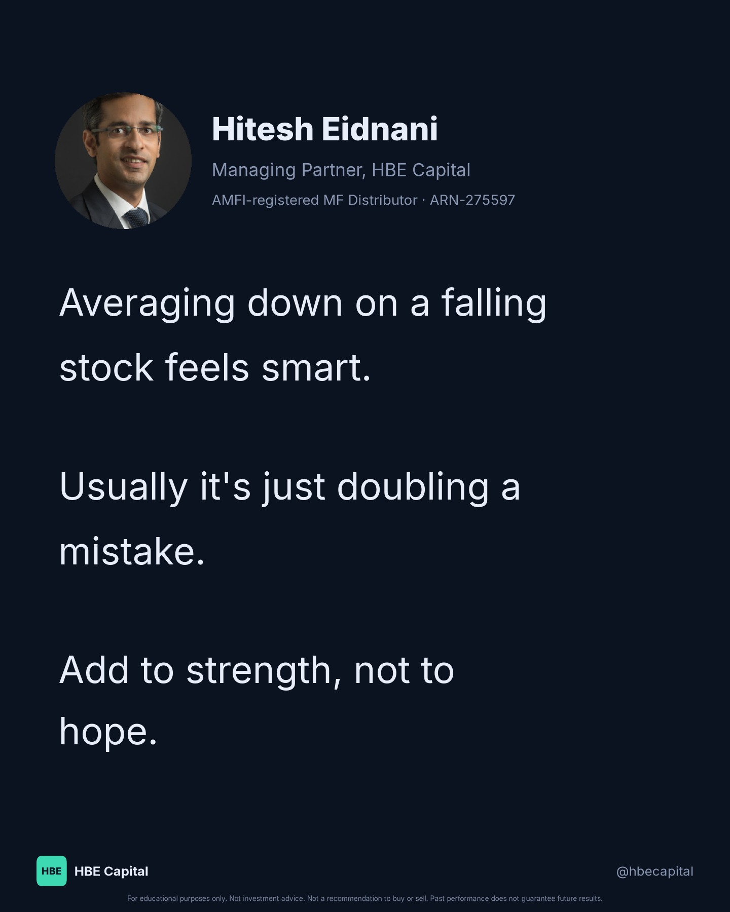

---

## Sun 15 Nov · 13:00 IST

```
"Trading effectively is about assessing probabilities, not certainties."
— Yvan Byeajee (TradingComposur on X)

No setup is certain. Think in probabilities and size your positions accordingly.

#tradingpsychology

📲 Instagram & YouTube: hbecapital
```

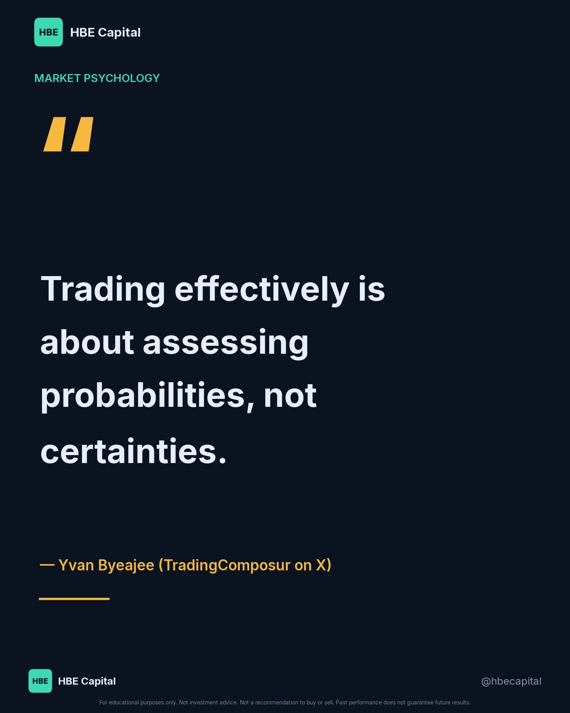

---

## Sun 15 Nov · 18:00 IST

```
₹5,000/month SIP for 20 years at an assumed 12% ≈ ₹46 lakh from ₹12 lakh invested.

Half the final value comes in the last 6 years. That's compounding.

(Illustration, not a projection.) #compounding

📲 Instagram & YouTube: hbecapital
```

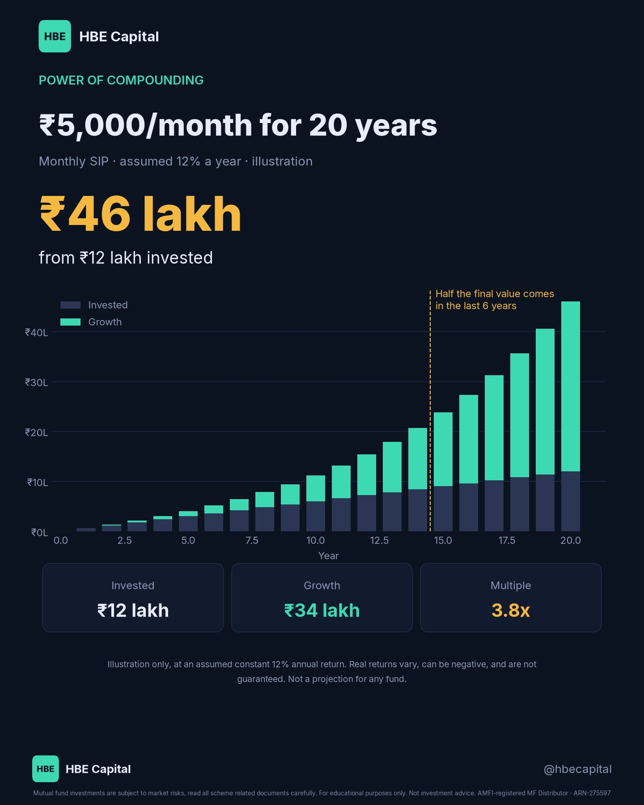

---

## Mon 16 Nov · 09:00 IST

```
Want to know if you're a long-term investor?

Check how often you open your portfolio app.

Daily is trading. Quarterly is investing.

#investing

📲 Instagram & YouTube: hbecapital
```

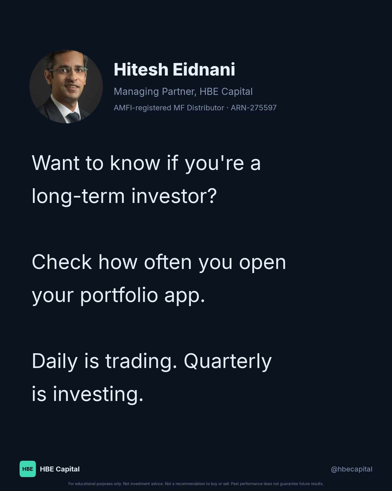

---

## Mon 16 Nov · 13:00 IST

```
"Bull markets are born on pessimism, grow on skepticism, mature on optimism and die on euphoria."
— Sir John Templeton

The mood of the crowd tells you where you are in the cycle. When everyone is euphoric, caution pays.

#tradingpsychology
```

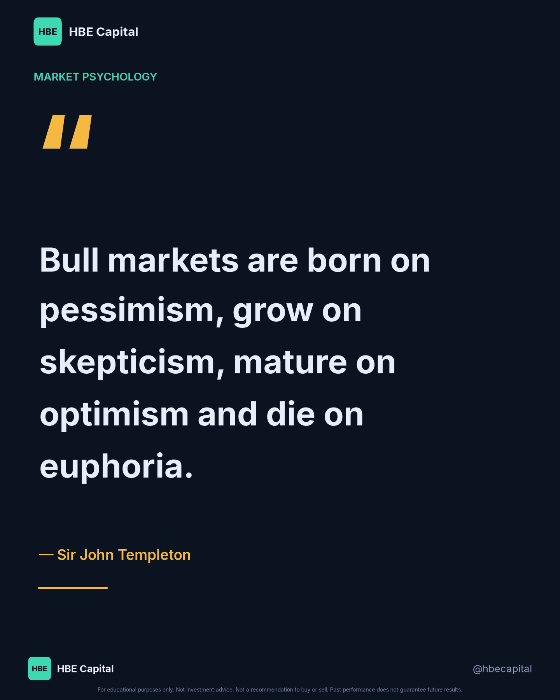

---

## Mon 16 Nov · 18:00 IST

```
MF Basics: STP and SWP explained

Two tools most investors don't know about.

💡 STP helps you invest gradually; SWP helps you withdraw gradually.

#mutualfunds

📲 Instagram & YouTube: hbecapital
```


---

## Tue 17 Nov · 09:00 IST

```
Asset allocation decides most of your returns.

Fund selection decides a little.

Tips decide nothing good.

#investing

📲 Instagram & YouTube: hbecapital
```

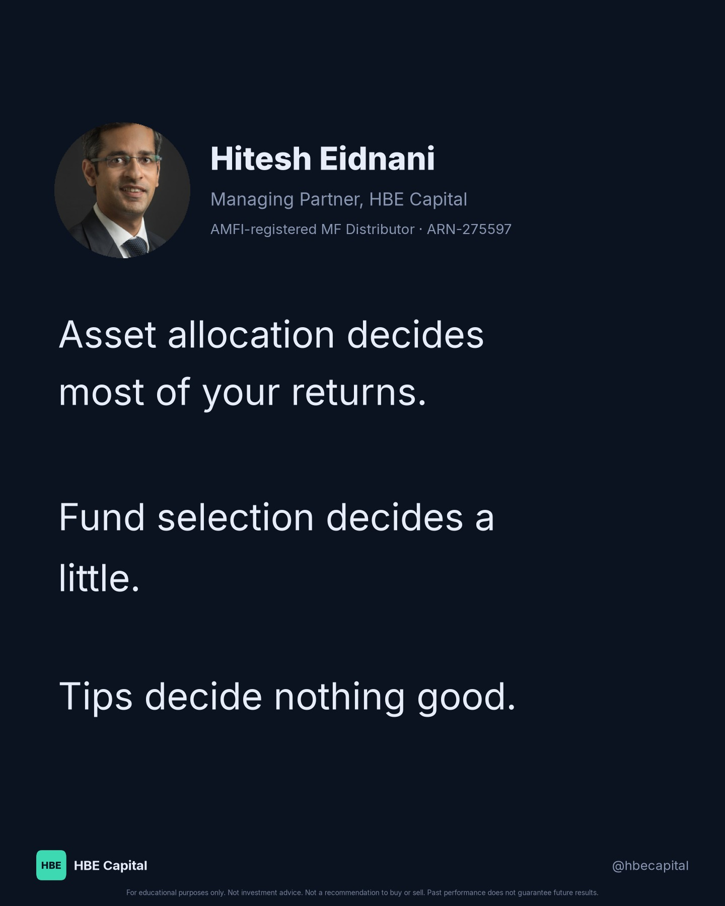

---

## Tue 17 Nov · 13:00 IST

```
"It's not whether you're right or wrong, but how much you make when you're right and how much you lose when you're wrong."
— George Soros (attributed)…
```

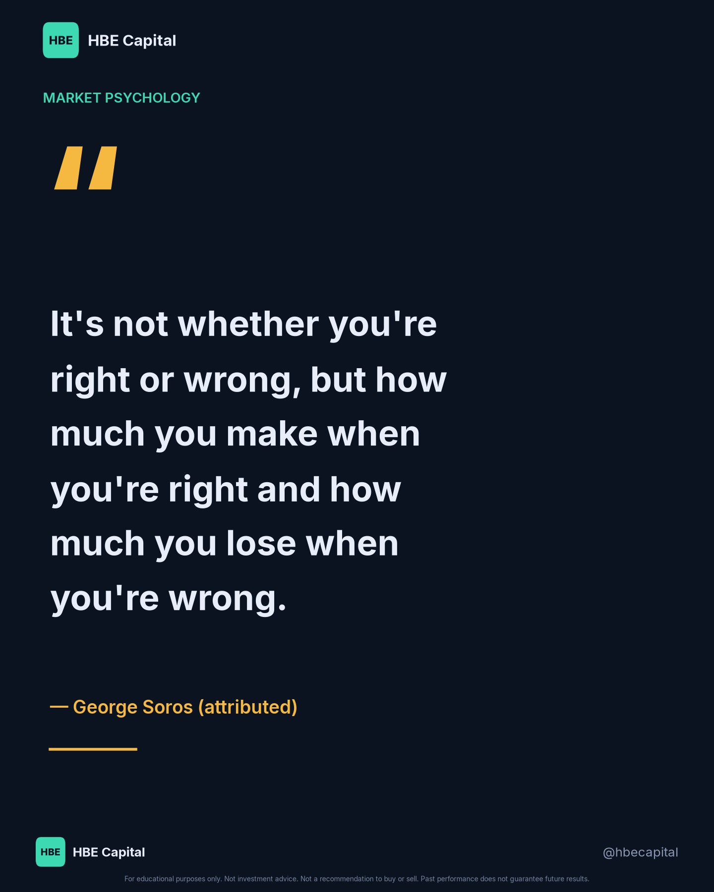

---

## Tue 17 Nov · 18:00 IST

```
Value vs Growth

Two styles, two very different bets.

💡 Value and growth take turns; momentum simply follows whichever is leading.

#momentuminvesting

📲 Instagram & YouTube: hbecapital
```


---

## Wed 18 Nov · 09:00 IST

```
Inflation is the tax nobody votes for.

Cash feels safe.
Over 10 years, it quietly isn't.

#investing

📲 Instagram & YouTube: hbecapital
```

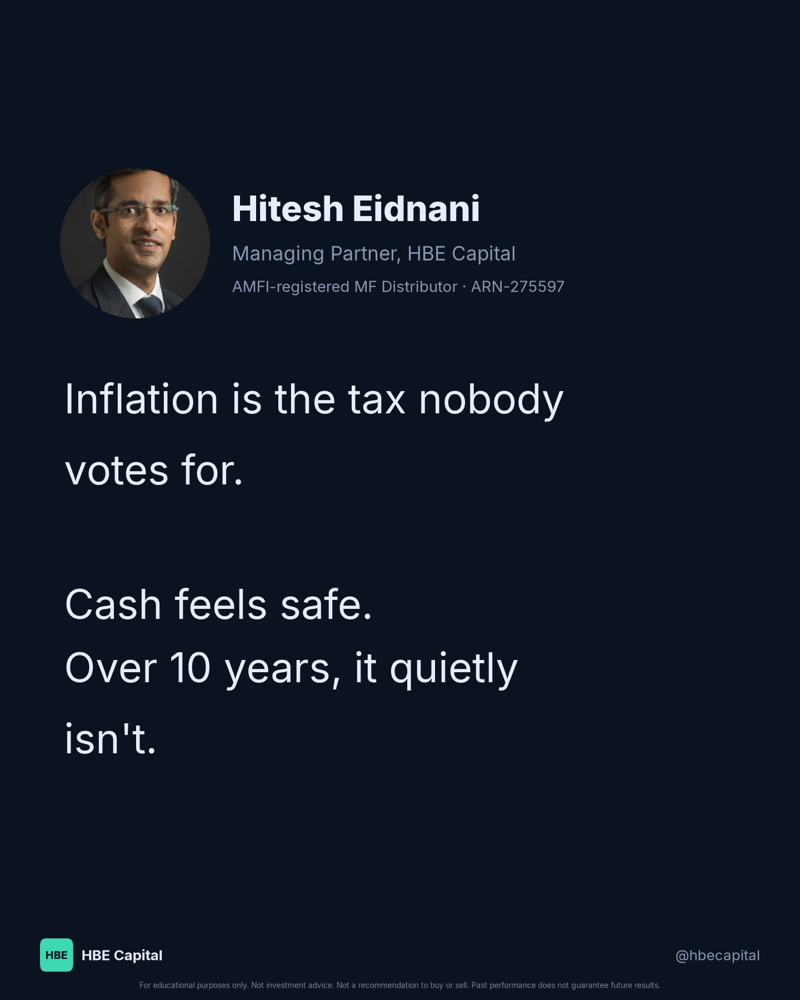

---

## Wed 18 Nov · 13:00 IST

```
"The market doesn't generate happy or painful information. From the market's perspective, it's all simply information."
— Mark Douglas

Pain comes from how we interpret price moves, not from the moves themselves. Neutral thinking leads to clearer decisions.…
```

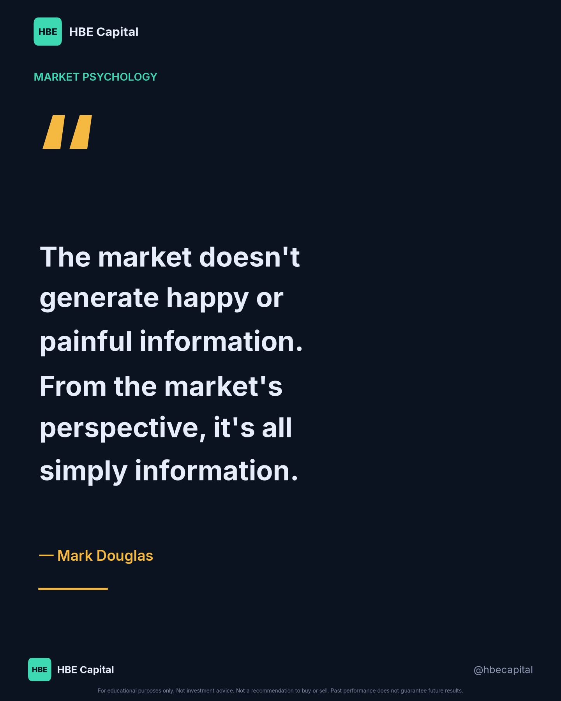

---

## Wed 18 Nov · 18:00 IST

```
"Bull markets are born on pessimism, grow on skepticism, mature on optimism, and die on euphoria."
— Sir John Templeton

The mood of the crowd tells you where you are in the cycle.

📲 Instagram & YouTube: hbecapital
```

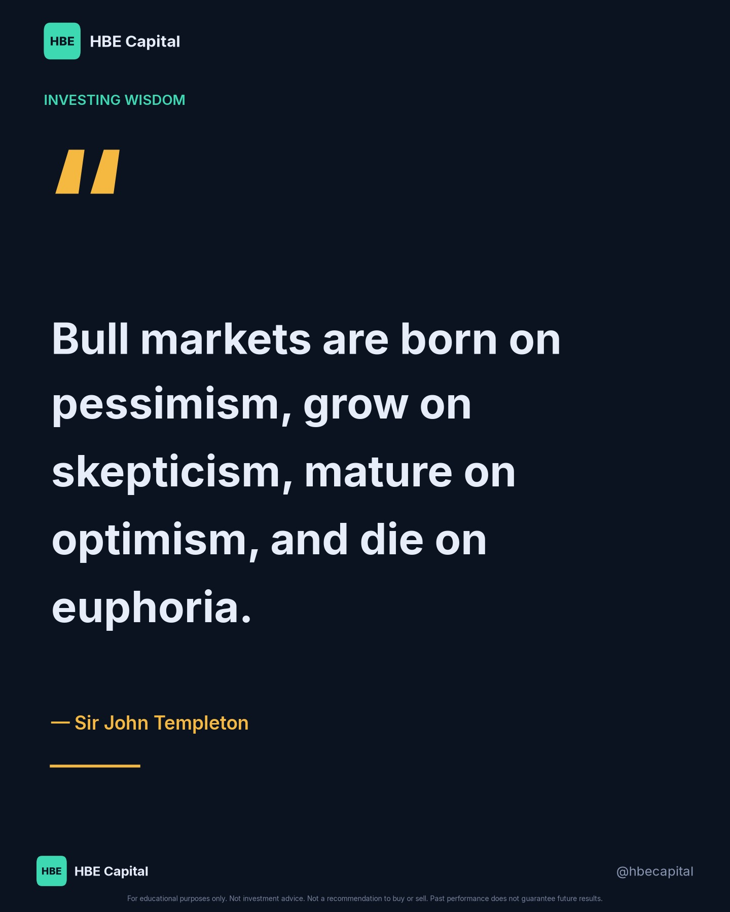

---
